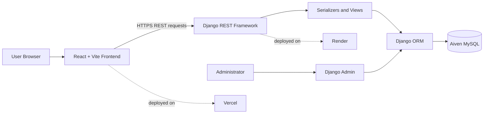

# 🧑‍💼 JobBoard — Full-Stack Job Listing Platform


A responsive, full-stack job board application built with **React 19 and Vite** on the frontend and **Python, Django, and Django REST Framework** on the backend. It supports job discovery, job-seeker registration and authentication, and job applications, with MySQL persistence and separate cloud deployments.

**[🌐 Live Application](https://job-board-app-lake-seven.vercel.app/)** · **[⚙️ Backend API](https://job-board-backend-thf9.onrender.com/)** · **[🛠️ Django Admin](https://job-board-backend-thf9.onrender.com/admin/)** · **[📂 GitHub Repository](https://github.com/SHAN2348/job-board-app)**

---

## 📌 Project Overview

JobBoard began as a React job-listing project with browser-based data persistence and a GitHub Actions deployment workflow. It was then extended with a Django REST backend and a MySQL production database.

The current architecture separates the frontend, backend API, and database:

- React provides the user interface and client-side navigation.
- Django REST Framework exposes API endpoints and validates requests.
- MySQL stores persistent application data.
- Vercel hosts the frontend, Render hosts the backend, and Aiven provides the production MySQL database.

## ✨ Features

### Job seeker experience

- Browse job listings.
- Search jobs with case-insensitive matching.
- Filter and explore job listings using the frontend's available filters.
- View job details.
- Register a job-seeker account.
- Log in through the backend authentication API.
- Submit job applications through the backend API.
- Responsive interface and theme support carried forward from the frontend implementation.

### Administration and backend

- Django Admin for authorized administrative management.
- Django REST Framework API.
- User registration with serializer validation.
- Token authentication endpoints.
- MySQL database integration.
- Django ORM and migrations.

> Public registration is currently restricted to the `job_seeker` role. Recruiter self-registration should not be assumed to be available.

### Engineering

- Git and GitHub source control.
- GitHub Actions workflow for frontend quality/build/deployment steps.
- Vercel frontend deployment.
- Render backend deployment.
- Environment-based API configuration.
- Backend automated tests.

## 🛠️ Technology Stack

| Layer | Technology | Purpose |
|---|---|---|
| Frontend | React 19 | UI components and application state |
| Build tool | Vite 6 | Development server and production build |
| Routing | React Router v7 | Client-side routing |
| Styling | CSS3 | Responsive layout and theming |
| Frontend linting | ESLint | Code-quality checks |
| Backend language | Python | Server-side application logic |
| Backend framework | Django | Web framework, ORM, admin and configuration |
| API | Django REST Framework | REST endpoints and serializers |
| Authentication | JWT endpoints | Token-based API authentication |
| Database | MySQL | Relational data storage |
| Production database | Aiven for MySQL | Managed cloud database |
| Frontend hosting | Vercel | React deployment |
| Backend hosting | Render | Django deployment |
| CI/CD | GitHub Actions | Automated workflow |
| Version control | Git and GitHub | Source control |

Check `package.json` and `backend/requirements.txt` for the exact dependency versions installed in the current repository.

## 🏗️ Architecture



### Typical API request flow

1. A user performs an action in the React application.
2. React sends an HTTP request to the configured backend API.
3. Django routes the request to the relevant view.
4. DRF serializers validate request data and serialize responses.
5. Django ORM reads or writes the relevant MySQL records.
6. Django returns an HTTP response, generally JSON for API requests.
7. React updates the page based on the response.

## 📁 Repository Structure

The following is a high-level structure. Refer to the actual repository for the latest files and exact names.

```text
job-board-app/
├── .github/
│   └── workflows/
│       └── ci.yml
├── public/
├── screenshots/
├── src/
│   ├── assets/
│   ├── components/
│   ├── context/
│   ├── data/
│   ├── pages/
│   │   ├── HomePage/
│   │   ├── JobListingPage/
│   │   ├── JobDetailsPage/
│   │   ├── AdminPage/          # Frontend page, if retained
│   │   ├── LoginPage/
│   │   └── RegisterPage/
│   ├── utils/
│   │   └── api.js
│   ├── App.jsx
│   └── main.jsx
├── backend/
│   ├── config/                 # Django project configuration
│   ├── jobs/                   # Job-board app, API and models
│   ├── manage.py
│   └── requirements.txt
├── package.json
└── README.md
```

## 🚀 Getting Started

### Prerequisites

- Git
- Node.js and npm
- Python
- MySQL for local development, or access to a compatible MySQL instance
- Visual Studio Code or another code editor

### 1. Clone the repository

```bash
git clone https://github.com/SHAN2348/job-board-app.git
cd job-board-app
```

### 2. Set up the backend

```bash
cd backend
python -m venv venv
```

Activate the virtual environment.

**Windows PowerShell**
```powershell
.\venv\Scripts\Activate.ps1
```

**macOS / Linux**
```bash
source venv/bin/activate
```

Install backend dependencies:

```bash
pip install -r requirements.txt
```

Create a private backend `.env` file with the variable names expected by `backend/config/settings.py`. For local development, use a local development database rather than production credentials.

Run database migrations and start Django:

```bash
python manage.py migrate
python manage.py runserver
```

The local backend normally runs at `http://127.0.0.1:8000/`.

### 3. Set up the frontend

Open a second terminal at the repository root:

```bash
npm install
```

Create `.env.local`:

```env
VITE_API_BASE_URL=http://127.0.0.1:8000
```

Start the frontend:

```bash
npm run dev
```

Vite prints the local frontend URL in the terminal (commonly `http://localhost:5173`).

### 4. Frontend quality checks

```bash
npm run lint
npm run build
```

The production build is generated in `dist/`.

## 🔐 Environment Variables

### Frontend

| Variable | Description | Local example |
|---|---|---|
| `VITE_API_BASE_URL` | Backend API origin | `http://127.0.0.1:8000` |

Production frontend configuration uses:

```env
VITE_API_BASE_URL=https://job-board-backend-thf9.onrender.com
```

Set this value in Vercel's project environment settings for the relevant deployment environment.

**Do not put secrets in `VITE_` variables.** Vite variables are included in browser-side code.

### Backend

The backend uses database configuration variables including:

| Variable | Purpose |
|---|---|
| `DB_NAME` | Database name |
| `DB_USER` | Database username |
| `DB_PASSWORD` | Database password |
| `DB_HOST` | Database hostname |
| `DB_PORT` | Database port |

Check `backend/config/settings.py` for the complete list of required settings, including Django secret key, debug mode, allowed hosts, CORS configuration, and database SSL options.

Never commit `.env` files, passwords, secret keys, access tokens, or database connection strings.

## 🔌 API Overview

Production API base URL:

```text
https://job-board-backend-thf9.onrender.com
```

| Method | Endpoint | Purpose |
|---|---|---|
| `GET` | `/api/jobs/` | Retrieve job listings |
| `POST` | `/api/register/` | Register a job-seeker account |
| `POST` | `/api/token/` | Obtain authentication tokens |
| `POST` | `/api/token/refresh/` | Refresh an access token |
| `GET` | `/api/me/` | Retrieve the authenticated user's information |
| Configured methods | `/api/applications/` | Job application resource |

The exact request fields, response bodies, supported methods, and permissions should be checked in the current backend URL configuration, views, serializers, and tests.

### Registration notes

The registration serializer accepts the registration information used by the frontend and creates users through Django's `create_user()` method. Django hashes the password before storing it. Public registration is restricted to the `job_seeker` role, and the serializer enforces a minimum password length.

## 🧪 Testing

### Backend tests

Run from the `backend` directory:

```bash
python manage.py test jobs
```

**Recorded development result:** 41 tests passed (`OK`).

Re-run the test suite against the current code before making a new release.

### Frontend checks

```bash
npm run lint
npm run build
```

The frontend production build was previously completed successfully. Check the current CI workflow and latest run for the most recent lint/build result.

### Manual workflow

The registration → login → home flow and continued job application flow were tested locally during development.

Recommended live smoke test:

1. Open the deployed frontend.
2. Register a disposable test job-seeker account.
3. Log in.
4. Browse and search jobs.
5. Submit an application using a test listing.
6. Check the corresponding data in Django Admin.
7. Refresh the frontend and verify that persisted data remains available.

## ☁️ CI/CD and Deployment

### GitHub Actions

The repository contains a workflow at `.github/workflows/ci.yml`. The earlier frontend workflow was configured to run lint/build and deploy steps on pushes to `main`, with deployment gated behind successful checks.

Because the backend was added later, inspect the current workflow file to confirm whether backend tests and backend deployment are also included. Do not assume that every service is deployed by the same workflow.

### Frontend — Vercel

- Repository: `SHAN2348/job-board-app`
- Production URL: https://job-board-app-lake-seven.vercel.app/
- Configure `VITE_API_BASE_URL` to point to the Render backend.
- Verify the build output and client-side route refresh behavior after deployment.

### Backend — Render

- Production URL: https://job-board-backend-thf9.onrender.com/
- Django REST API is hosted as a Render web service.
- Configure dependencies, start command, environment variables, allowed hosts, CORS, and database SSL.
- Apply migrations as part of the deployment process as configured by the service.

### Database — Aiven

- Production database: Aiven for MySQL.
- Django connects using private host, port, database, username, password, and SSL configuration.
- Keep credentials in private environment variables.
- Apply migrations against the intended database.

### Django Admin

Production admin:

https://job-board-backend-thf9.onrender.com/admin/

The production superuser was created using Django's `createsuperuser` management command from the local backend environment after verifying that the local Django process was connected to Aiven. This was used because interactive Shell and One-Off Jobs were unavailable on the Render Free compute plan.

## 🔒 Security and Production Considerations

- Keep Django `DEBUG` disabled in production.
- Use a strong, unique Django secret key.
- Restrict `ALLOWED_HOSTS` to trusted backend hostnames.
- Configure CORS only for trusted frontend origins.
- Use HTTPS for production traffic.
- Use the database provider's recommended SSL configuration.
- Never expose database credentials or JWT secrets in frontend code.
- Keep passwords hashed using Django's user-creation/authentication APIs.
- Review object-level permissions for job applications and user-owned records.
- Back up the production database and document restore steps.

## 🔮 Future Improvements

Potential enhancements (not claims about currently implemented features):

- Recruiter registration and role-based recruiter dashboard.
- Advanced job filters, pagination, and sorting at the API level.
- Saved jobs and candidate profiles.
- Resume upload and application status tracking.
- Email notifications.
- More frontend unit and end-to-end tests.
- Production monitoring, structured logs, and error reporting.
- Automated deployment smoke tests.
- Accessibility and performance audits.

## 📚 Additional Documentation

- [Architecture](docs/ARCHITECTURE.md)
- [Setup and Deployment](docs/SETUP_AND_DEPLOYMENT.md)
- [API Reference](docs/API_REFERENCE.md)
- [Testing Guide](docs/TESTING.md)
- [Interview Walkthrough](docs/INTERVIEW_WALKTHROUGH.md)

## 📄 License

The previous README identified this project as MIT licensed. Keep that statement only if the repository's `LICENSE` file is present and contains the MIT License text. See [LICENSE](LICENSE).

## 👨‍💻 Author

**Shaik Shan Shareef**

- GitHub: [@SHAN2348](https://github.com/SHAN2348)
- Repository: [job-board-app](https://github.com/SHAN2348/job-board-app)
