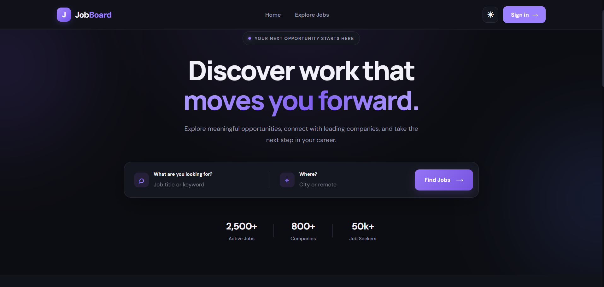
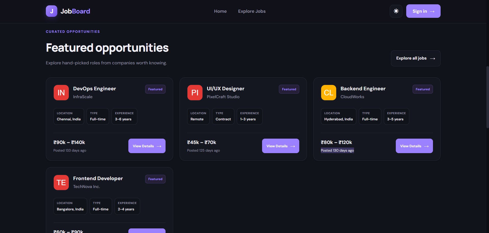
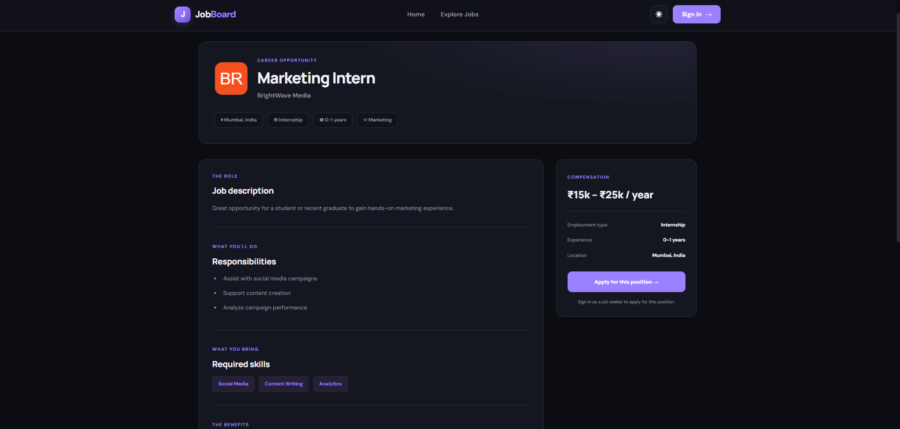
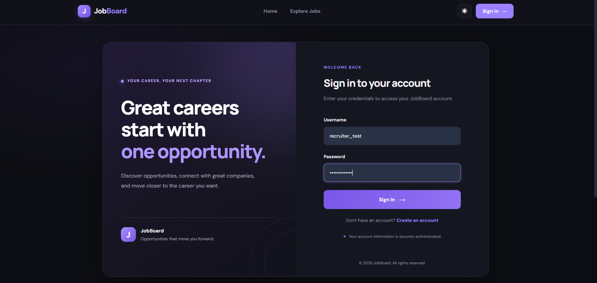
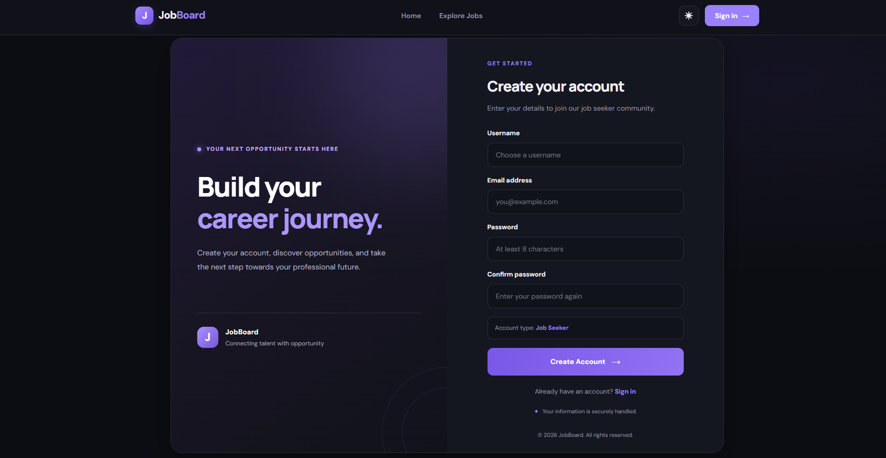
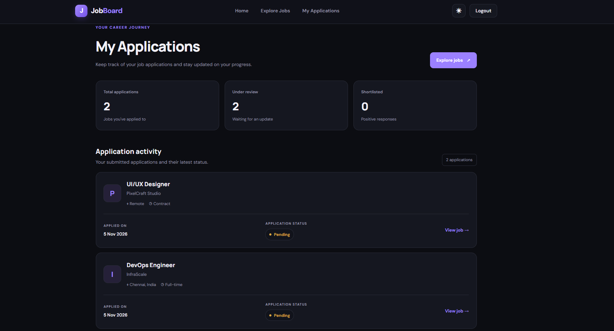
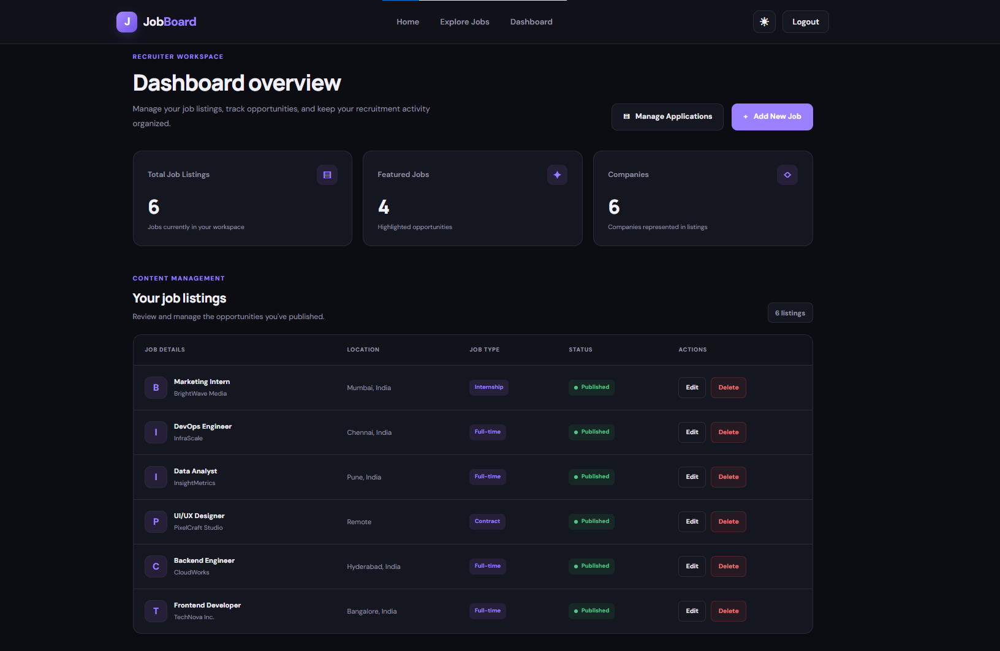
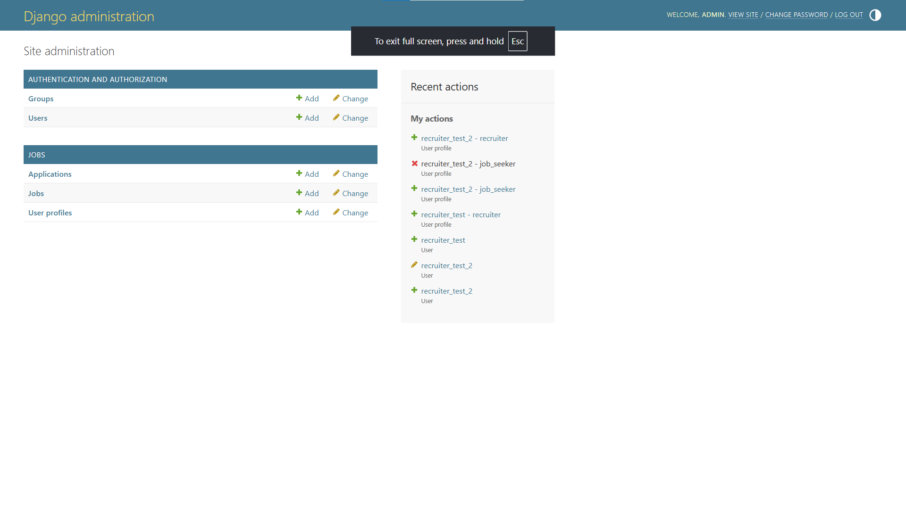

# Job Board Application

A responsive job listing platform built with **React** and progressively
developed into a full-stack application using **Django REST Framework**
and **MySQL**. The application brings together job discovery, job
management, user roles, authentication, and application review in one
place.

-   **Live frontend (original deployment):**
    https://job-board-app-lake-seven.vercel.app/
-   **Live frontend:** https://job-board-app-lake-seven.vercel.app/
-   **Live backend:** https://job-board-backend-thf9.onrender.com/
-   **Django Admin:** https://job-board-backend-thf9.onrender.com/admin/
-   **GitHub repository:** https://github.com/SHAN2348/job-board-app

> **Project status:** The React frontend is hosted on Vercel, the Django
> REST API is hosted on Render, and the production relational database
> is hosted on Aiven MySQL. Deployment configuration and environment
> secrets are managed separately from the source code.

------------------------------------------------------------------------

## Table of contents

1.  [Project overview](#project-overview)
2.  [Features](#features)
3.  [Screenshots](#screenshots)
4.  [Technology stack](#technology-stack)
5.  [Architecture and request flow](#architecture-and-request-flow)
6.  [How the technologies are used](#how-the-technologies-are-used)
7.  [Development journey](#development-journey)
8.  [Authentication and roles](#authentication-and-roles)
9.  [Database](#database)
10. [API integration](#api-integration)
11. [Run the project locally](#run-the-project-locally)
12. [Testing and verification](#testing-and-verification)
13. [Git, GitHub, CI/CD and deployment](#git-github-cicd-and-deployment)
14. [Troubleshooting notes](#troubleshooting-notes)
15. [Current status and next steps](#current-status-and-next-steps)
16. [Learning outcomes](#learning-outcomes)
17. [License](#license)

------------------------------------------------------------------------

## Project overview

The Job Board Application helps users discover job opportunities and
provides an administrative/recruiter workflow for managing job listings
and reviewing applications.

The project began as a frontend-focused React application. Job
information was initially supplied by local JSON data and browser
`localStorage`. As the project grew, that approach was replaced for the
main job data with a Python backend:

-   React is responsible for the user interface, navigation, forms, and
    client-side interaction.
-   Django REST Framework exposes HTTP API endpoints and handles
    server-side application logic.
-   MySQL stores persistent application data.
-   JWT-based authentication identifies signed-in users.
-   Role-based permissions separate recruiter operations from job-seeker
    operations.

This progression demonstrates the move from a client-side prototype to a
frontend-and-backend application.

## Features

### Job discovery

-   Browse available job listings.
-   Search jobs using the available search interface.
-   Filter job listings using the available filter controls.
-   Open a job to view its details.
-   Display job information such as company details, responsibilities,
    and benefits where supplied.

### Job management

-   Retrieve job listings from the Django API.
-   Create job listings through the admin/recruiter interface.
-   Update existing job listings.
-   Delete job listings.
-   Send create, update, and delete requests through the shared frontend
    API request helper.

Write operations are protected by backend authentication and role
permissions.

### Accounts and access control

-   User registration and login.
-   JWT-based authentication.
-   Recruiter and job-seeker roles.
-   Public registration is intended for job seekers.
-   Recruiter accounts are managed through Django Admin rather than
    unrestricted public recruiter registration.
-   Protected operations require an authenticated user with the
    appropriate permissions.

### Application management

-   View submitted job applications in the management interface.
-   Review application information.
-   Work with application statuses such as Pending, Reviewed,
    Shortlisted, and Rejected.

The application-management interface has been developed and exercised
with application records. The full application API workflow and all
status transitions should be treated as ongoing verification until each
has been tested end to end.

### Frontend experience

The original frontend also includes:

-   Responsive layouts.
-   Job search and filtering.
-   Featured jobs and category-based browsing.
-   Job detail pages.
-   Admin job-management screens.
-   Dark mode.
-   Toast messages and empty/loading states.
-   Client-side navigation using React Router.

------------------------------------------------------------------------

## Screenshots

The screenshots below show the main user-facing workflows. Add your
actual application screenshots to the existing `screenshots/` folder
using the filenames shown here. If your filenames differ, update the
image paths accordingly.

| Home page | Job listings and search |
|---|---|
|  |  |

| Job details | Login |
|---|---|
|  |  |

| Registration | My applications |
|---|---|
|  |  |

| Admin job management | Django Admin |
|---|---|
|  |  |

> **Adding screenshots:** Save each image in the `screenshots/` folder
> with the matching filename. Remove any row for a screen that is not
> implemented or not ready to show publicly. Do not include screenshots
> containing passwords, access tokens, personal data, or secret settings.

------------------------------------------------------------------------

## Technology stack

  -----------------------------------------------------------------------
  Layer                   Technology              Purpose
  ----------------------- ----------------------- -----------------------
  Frontend                React 19                Builds reusable UI
                                                  components and pages

  Frontend tooling        Vite                    Development server and
                                                  production build

  Language                JavaScript              Frontend application
                                                  logic

  Routing                 React Router v7         Navigation between
                                                  application pages

  Styling                 CSS3                    Layout, responsive
                                                  styling, and theme
                                                  styles

  Backend language        Python                  Server-side application
                                                  logic

  Backend framework       Django 5.2.18           Backend project,
                                                  models, and application
                                                  structure

  API framework           Django REST Framework   REST API endpoints,
                                                  serialization, and API
                                                  responses

  Database                MySQL 8.0.46            Persistent relational
                                                  data storage

  Authentication          JSON Web Tokens (JWT)   Authenticated API
                                                  access

  Frontend API            Shared `apiRequest`     Sends requests from
  integration             helper                  React to the backend

  Code quality            ESLint                  Frontend code linting

  Version control         Git                     Tracks source-code
                                                  changes

  Repository hosting      GitHub                  Stores code and
                                                  workflow configuration

  CI/CD                   GitHub Actions          Automates frontend
                                                  checks and deployment
                                                  workflow

  Frontend hosting        Vercel                  Hosts the original
                                                  frontend deployment
  -----------------------------------------------------------------------

### Why this stack?

**React + Vite:** React makes it possible to divide the interface into
reusable components. Vite provides a fast local development environment
and creates an optimized production build.

**Django + Django REST Framework:** Django provides the backend
structure, while DRF makes it possible to expose application
functionality through REST APIs. This keeps backend business logic
separate from the frontend.

**MySQL:** A relational database is suitable for structured data such as
users, job listings, and applications, including relationships between
these records.

**JWT:** Tokens allow the frontend to authenticate API requests without
relying on a traditional server-rendered page session for every request.

------------------------------------------------------------------------

## Architecture and request flow

The application uses a frontend/backend architecture.

``` text
                  USER / BROWSER
                        |
                        v
              REACT 19 + VITE
                        |
              React Router v7
                        |
               React Pages and
                Components
                        |
                        v
              API REQUEST HELPER
                  apiRequest
                        |
                 HTTP / REST
                        |
                        v
             DJANGO REST FRAMEWORK
                        |
              Authentication and
                Permissions
                        |
                        v
                 DJANGO LOGIC
                        |
                        v
                    MySQL
                        |
                 API Response
                        |
                        v
               React updates UI
```

### Example: loading job listings

1.  A user opens the job listings page.
2.  React renders the page and initiates a request.
3.  The frontend API helper sends an HTTP `GET` request to `/api/jobs/`.
4.  Django REST Framework receives the request.
5.  The backend retrieves job records from MySQL.
6.  DRF serializes the records into JSON.
7.  Django returns an HTTP response.
8.  React uses the returned data to display job cards.

A successful local API check returned **6 job records** from
`GET /api/jobs/`.

### Example: creating a job

1.  An authorized recruiter/admin opens the job form.
2.  The user enters the job information.
3.  React validates and submits the form.
4.  The API helper sends a `POST` request.
5.  Django checks authentication, permissions, and submitted data.
6.  The backend saves the new record to MySQL.
7.  The API returns a response.
8.  React updates the interface based on the result.

The same general flow is used for updating and deleting job listings
with `PUT` and `DELETE` requests.

------------------------------------------------------------------------

## How the technologies are used

### 1. React 19

React is used to build the user interface as reusable components rather
than placing the entire application in one large file.

The project separates reusable UI elements from route-level pages and
shared application logic.

React state is used for interactive interface behavior, such as search,
filters, form values, and displayed data.

### 2. Vite

Vite is used to:

-   Create and run the React development environment.
-   Serve the application locally.
-   Resolve frontend dependencies.
-   Build optimized production assets.

Commands:

``` bash
npm install
npm run dev
npm run build
```

The production build is generated in the `dist/` directory.

### 3. React Router v7

React Router manages navigation between pages without requiring a
complete browser reload for every route change.

It is used for the application's page navigation, including the home
page, job listings, job details, and administration screens.

### 4. JavaScript

JavaScript handles frontend behavior, including:

-   Event handling.
-   Form input and validation.
-   State updates.
-   API request handling.
-   Search and filtering interactions.
-   Displaying API results and error messages.

### 5. Python

Python is used for backend development. It handles server-side
operations and works with Django and Django REST Framework.

### 6. Django 5.2.18

Django provides the backend foundation.

It is used for:

-   Project configuration.
-   Application organization.
-   Database models and ORM operations.
-   User management.
-   Authentication integration.
-   Django Admin.
-   URL configuration.
-   Database migrations.

### 7. Django REST Framework

DRF exposes backend functionality as REST APIs.

It is used for:

-   Receiving HTTP requests.
-   Validating incoming data through serializers.
-   Returning JSON responses.
-   Handling job-related API operations.
-   Applying authentication and permission rules.
-   Connecting the React frontend to backend data.

### 8. MySQL 8.0.46

MySQL stores the application's persistent data.

Django communicates with MySQL through its database configuration and
ORM. This avoids writing raw SQL for every normal model operation.

The backend's job-listing API was checked locally and returned six
records.

### 9. JWT authentication

JWT is used to authenticate API requests.

The frontend includes authentication information when calling protected
backend operations. Django REST Framework verifies the token and applies
the configured permission rules.

The project also includes registration security validation. Automatic
JWT refresh was still being verified at the time of this documentation.

### 10. ESLint

ESLint is used to identify frontend code-quality problems and enforce
the project's configured lint rules.

Run:

``` bash
npm run lint
```

### 11. Git and GitHub

Git tracks changes during development. GitHub hosts the source code and
stores the GitHub Actions workflow.

Typical workflow:

``` bash
git status
git add .
git commit -m "Describe the changes"
git push origin main
```

### 12. GitHub Actions and Vercel

The original frontend project uses GitHub Actions to automate the
frontend quality-check and deployment workflow.

The workflow is configured to:

1.  Run ESLint.
2.  Create a production build.
3.  Deploy to Vercel when the required checks pass.

The workflow file is located under:

``` text
.github/
└── workflows/
    └── ci.yml
```

The React frontend is deployed on Vercel and the Django REST backend is
deployed separately on Render. The backend connects to Aiven MySQL for
production data storage.

------------------------------------------------------------------------

## Development journey

The project was developed in stages.

### Stage 1 --- Initial frontend setup

-   Created the React application using Vite.
-   Installed the frontend dependencies.
-   Organized the application into components and pages.
-   Configured React Router for page navigation.
-   Started the development server and checked the application in a
    browser.

### Stage 2 --- Job board interface

-   Developed the job listing interface.
-   Created reusable job cards and other UI components.
-   Added job details pages.
-   Implemented search and filtering interactions.
-   Added the administration interface for job management.
-   Worked on responsive design and dark mode.

### Stage 3 --- Initial data handling

The first version used JSON job data and browser `localStorage`.

This made it possible to demonstrate job listing and management behavior
without a backend.

However, browser storage is specific to a user's browser and is not a
replacement for shared, centralized application data.

### Stage 4 --- Backend development

The application was extended with Django 5.2.18 and Django REST
Framework.

Backend responsibilities were separated from frontend responsibilities.

The backend is deployed on Render and uses the Aiven MySQL production database. The backend handles:

-   Job listing data.
-   Job creation, retrieval, updating, and deletion.
-   User authentication.
-   Recruiter and job-seeker roles.
-   Application-management functionality.

### Stage 5 --- MySQL integration

-   Installed and configured MySQL Server.
-   Connected the Django project to MySQL.
-   Used Django's ORM for database operations.
-   Created and applied database migrations.
-   Checked the jobs API to verify that database records could be
    retrieved.

### Stage 6 --- Authentication and registration security

-   Integrated JWT authentication.
-   Added role-aware access control.
-   Worked on restricting public registration to job seekers.
-   Kept recruiter account management under Django Admin.
-   Checked registration security validation.

### Stage 7 --- React and Django integration

-   Connected the React application to the Django API.
-   Replaced the earlier frontend-only job data service with backend API
    integration.
-   Removed the old `jobsService.js` data-service approach.
-   Used a shared `apiRequest` helper for API communication.
-   Connected admin job creation, updating, and deletion operations to
    the backend.

### Stage 8 --- Verification and build

-   Checked the jobs API response.
-   Ran registration security tests.
-   Built the React application.
-   Continued checking the authentication and application-management
    workflow.

------------------------------------------------------------------------

## Authentication and roles

The application distinguishes between two user roles.

  -----------------------------------------------------------------------
  Role                                Main responsibility
  ----------------------------------- -----------------------------------
  Job Seeker                          Discover job opportunities and use
                                      job-seeker functionality

  Recruiter                           Manage job listings and review
                                      applications
  -----------------------------------------------------------------------

### Job seeker

A job seeker uses the public registration flow and can sign in to access
the functionality allowed by the backend.

### Recruiter

Recruiter accounts are managed through Django Admin rather than being
created through unrestricted public registration.

Recruiter permissions are intended to protect job-management operations
from unauthorized users.

### JWT request flow

``` text
User submits login form
          |
          v
React sends login request
          |
          v
Django validates credentials
          |
          v
JWT token response
          |
          v
Frontend handles authentication
          |
          v
Protected API request
          |
          v
Django verifies token
          |
          v
Permission check
          |
          v
API response
```

Authentication and authorization are different:

-   **Authentication:** verifies who the user is.
-   **Authorization:** determines what the authenticated user is allowed
    to do.

------------------------------------------------------------------------

## Database

MySQL 8.0.46 is used as the relational database for the backend.

Django models represent application data, and Django's ORM handles
normal database operations.

The main data areas include:

-   User and role information.
-   Job listings.
-   Job application information.

Conceptually, a job application connects a job seeker to a job listing.
The exact database fields and relationship definitions are maintained in
the Django models.

### Database setup

After configuring the MySQL connection in Django:

``` bash
python manage.py makemigrations
python manage.py migrate
```

To inspect the configured database and available models, use Django's
management commands and Django Admin.

> Keep database passwords and other credentials out of Git. Use local
> configuration or environment-based secrets, and provide example
> placeholders rather than real credentials in shared documentation.

------------------------------------------------------------------------

## API integration

The frontend communicates with Django through HTTP requests.

One locally verified endpoint is:

  -----------------------------------------------------------------------
  Method            Endpoint          Purpose           Verification
  ----------------- ----------------- ----------------- -----------------
  GET               `/api/jobs/`      Retrieve job      Returned 6
                                      listings          records locally

  -----------------------------------------------------------------------

The job-management interface is connected to create, update, and delete
operations through the shared `apiRequest` helper.

The exact route names for registration, login, token refresh, individual
job operations, and applications should be taken from the current Django
URL configuration rather than guessed in documentation.

### HTTP methods used

  Method   Typical purpose
  -------- ----------------------------------
  GET      Retrieve data
  POST     Create a resource or submit data
  PUT      Replace/update a resource
  PATCH    Partially update a resource
  DELETE   Remove a resource

### Why use a shared API helper?

A shared request helper avoids duplicating request logic across every
component.

It provides a central place to handle common request configuration,
authentication headers, and response/error handling.

------------------------------------------------------------------------

## Run the project locally

The commands below describe the normal local setup. Run backend and
frontend in separate terminals.

### Prerequisites

Install:

-   Python version compatible with the project's installed Django version.
-   pip.
-   Node.js and npm.
-   MySQL Server 8.0 or a compatible version.
-   Git.
-   A code editor such as Visual Studio Code.

### 1. Clone the repository

``` bash
git clone https://github.com/SHAN2348/job-board-app.git
cd job-board-app
```

The repository contains the frontend and backend project files. Run the
frontend and backend from their respective directories as described
below.

### 2. Frontend setup

Open a terminal in the React project directory:

``` bash
npm install
npm run dev
```

Open the local URL printed by Vite, normally:

``` text
http://localhost:5173
```

Build the frontend:

``` bash
npm run build
```

Run lint checks:

``` bash
npm run lint
```

### 3. Backend setup

Open a separate terminal in the directory containing Django's
`manage.py`:

``` bash
python -m venv venv
```

On Windows PowerShell:

``` powershell
.\venv\Scripts\Activate.ps1
```

On Windows Command Prompt:

``` bat
venv\Scripts\activate
```

Install the backend dependencies from the project's dependency file, if
provided:

``` bash
pip install -r requirements.txt
```

Configure the Django database settings to connect to your local MySQL
server. Do not commit passwords or secret keys.

Apply migrations:

``` bash
python manage.py makemigrations
python manage.py migrate
```

Create an administrator account:

``` bash
python manage.py createsuperuser
```

Start the backend:

``` bash
python manage.py runserver
```

The default Django development address is:

``` text
http://127.0.0.1:8000/
```

Django Admin is normally available at:

``` text
http://127.0.0.1:8000/admin/
```

### 4. Connect frontend and backend

Make sure the frontend's API configuration points to the local Django
backend and that Django's CORS configuration permits the frontend's
development origin.

Set `VITE_API_BASE_URL` in the frontend environment configuration to
`http://127.0.0.1:8000` for local development. Use the deployed Render
API base URL in the Vercel environment configuration for production.

### 5. Run the full application

1.  Start MySQL Server.
2.  Start Django in the backend terminal.
3.  Start Vite in the frontend terminal.
4.  Open the frontend in your browser.
5.  Verify that the frontend can retrieve data from Django.

------------------------------------------------------------------------

## Testing and verification

Testing was performed progressively while the application was being
developed.

### 1. Frontend development check

**Tool:** Vite development server and browser.

The application was opened locally to inspect page rendering,
navigation, job listing behavior, and frontend interactions.

### 2. API retrieval check

**Tool:** Local Django API/browser or API client.

Request:

``` http
GET /api/jobs/
```

Observed result:

-   The endpoint responded with job data.
-   Six job records were returned.

This confirmed that the local React/backend development work had a
working job-list retrieval endpoint and that the backend could retrieve
records from its configured database.

### 3. Backend automated tests

**Tool:** Django test runner.

Command:

``` bash
python manage.py test jobs
```

Recorded result: **41 tests passed**. This confirms the test cases in the
`jobs` app passed at the time they were run; it is not a claim of complete
coverage of every possible production scenario.

### 4. Frontend production build

**Tool:** npm and Vite.

Command:

``` bash
npm run build
```

Latest recorded result:

``` text
Build: successful
Modules transformed: 59
```

An earlier build also succeeded with 58 modules. The later successful
build contained 59 modules.

This verifies that Vite could compile the frontend into production
assets at that point in development.

### 5. Admin job-management integration

The admin job-management interface was connected to the backend request
helper for:

-   POST --- create a job.
-   PUT --- update a job.
-   DELETE --- delete a job.

The integration work was completed in the frontend. Each operation
should also be independently verified against the running backend,
including database persistence and permission checks, before being
marked as fully tested.

### 6. Application-management interface check

The management interface was exercised with an application record and
displayed information including:

-   Applicant information.
-   Job title.
-   Company.
-   Application date.
-   Current status.
-   Status choices: Pending, Reviewed, Shortlisted, Rejected.

This confirms that the application-management screen was exercised. It
does not by itself prove that every status update is successfully
persisted through the backend API.

### 7. GitHub Actions verification

The original frontend workflow was configured to run linting, build, and
Vercel deployment.

Check the repository's Actions tab for the latest workflow run before
claiming that a particular commit passed all CI/CD stages.

### Testing status summary

  -----------------------------------------------------------------------
  Test or activity                    Recorded status
  ----------------------------------- -----------------------------------
  Local jobs API retrieval            Passed --- 6 records returned

  Django backend test suite            Passed --- 41 tests

  React production build              Passed during development

  Admin POST/PUT/DELETE frontend      Connected; individual backend
  integration                         verification remains necessary

  Application-management screen       Exercised with an application
                                      record

  Production backend hosting           Deployed on Render

  Production database                 Aiven MySQL

  Full deployed user journeys          Continue regression testing after
                                      code or configuration changes
  -----------------------------------------------------------------------

### Recommended end-to-end test sequence

Use this checklist when completing the remaining verification:

-   [ ] Register a new job-seeker account.
-   [ ] Verify that invalid registration data is rejected.
-   [ ] Log in with valid credentials.
-   [ ] Verify that an authenticated API request succeeds.
-   [ ] Verify that an unauthenticated protected request is rejected.
-   [ ] Verify that a job seeker cannot perform recruiter-only
    operations.
-   [ ] Log in as a recruiter.
-   [ ] Create a job and confirm it appears in the database.
-   [ ] Update the job and confirm the changes persist.
-   [ ] Delete the job and confirm it is removed.
-   [ ] Browse, search, and filter the available jobs.
-   [ ] Submit a job application as a job seeker.
-   [ ] Confirm that the application is stored.
-   [ ] Review the application as an authorized recruiter.
-   [ ] Change the application status and verify that the change
    persists.
-   [ ] Test JWT expiration and automatic refresh.
-   [ ] Run frontend lint and production build.
-   [ ] Run the backend test suite.
-   [ ] Verify the deployed frontend and backend together.

------------------------------------------------------------------------

## Git, GitHub, CI/CD and deployment

### Version control workflow

Git was used to track development changes and GitHub was used to host
the project.

A typical update workflow:

``` bash
git status
git add .
git commit -m "Integrate Django API with React frontend"
git push origin main
```

### CI/CD workflow

The original frontend CI/CD pipeline uses GitHub Actions.

``` text
Developer pushes code to GitHub
              |
              v
        GitHub Actions
              |
              v
          ESLint check
              |
              v
        Production build
              |
       Checks successful?
              |
              v
       Vercel deployment
```

The workflow is defined in `.github/workflows/ci.yml`.

### Frontend deployment

The original frontend is hosted on Vercel:

https://job-board-app-lake-seven.vercel.app/

### Backend deployment

The Django backend's local development and integration should not be
confused with production deployment. A production backend host,
production MySQL database, environment secrets, allowed hosts, CORS
settings, and frontend API URL must all be configured before the
full-stack deployment is complete.

------------------------------------------------------------------------

## Troubleshooting notes

### Frontend does not start

Check that dependencies are installed:

``` bash
npm install
npm run dev
```

### Backend cannot connect to MySQL

Check:

-   MySQL Server is running.
-   The database exists.
-   Django's database name, username, password, host, and port are
    correct.
-   The configured MySQL driver is installed.

### Frontend cannot access the API

Check:

-   Django is running.
-   The frontend API base URL is correct.
-   The API endpoint is correct.
-   CORS permits the frontend origin.
-   The browser developer console and network tab for the actual
    response.

### Protected API returns an authentication error

Check:

-   The user is logged in.
-   The frontend sends the expected authorization header.
-   The token is valid and has not expired.
-   The user has the required role and permission.

### Database changes are not visible

Check that:

-   The correct MySQL database is configured.
-   Migrations have been applied.
-   The API request completed successfully.
-   The frontend is displaying the latest API response rather than stale
    local data.

------------------------------------------------------------------------

## Current status and next steps

The application is deployed as a React frontend on Vercel and a Django
REST backend on Render, connected to Aiven MySQL. The backend test suite
was run successfully with **41 tests passing**. The frontend production
build was also verified successfully during development.

Further improvements can include broader end-to-end browser testing,
additional monitoring and logging, and expanding automated CI checks to
cover the backend as well as the frontend.

------------------------------------------------------------------------

## Learning outcomes

This project demonstrates practical experience with:

-   Building a React application using reusable components.
-   Managing frontend navigation with React Router.
-   Working with JavaScript state and form interactions.
-   Building backend applications with Python and Django.
-   Developing REST APIs using Django REST Framework.
-   Connecting a React frontend to a Python backend.
-   Using MySQL with Django ORM.
-   Implementing JWT authentication.
-   Understanding role-based authorization.
-   Performing CRUD operations.
-   Validating API responses and debugging integration issues.
-   Using Git and GitHub for version control.
-   Building frontend assets with Vite.
-   Automating frontend checks and deployment through GitHub Actions.

## License

This project is distributed under the MIT License. See the `LICENSE`
file in the repository for details.
