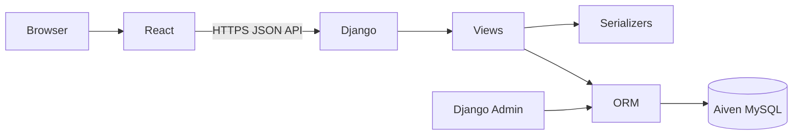

# Architecture

## System components

- **React + Vite:** browser interface, client-side routing, forms, and API calls.
- **Django + Django REST Framework:** URL routing, API views, serializers, validation, authentication, permissions, and business logic.
- **Django ORM:** maps Python models to relational database operations.
- **Aiven MySQL:** production relational database.
- **Vercel:** frontend hosting.
- **Render:** backend hosting.

## Request lifecycle

1. User interacts with a React component.
2. Frontend sends a request to the configured `VITE_API_BASE_URL`.
3. Django resolves the URL and invokes the corresponding view.
4. DRF serializer validates request data or serializes response data.
5. View and ORM perform the required database operation.
6. Django returns an HTTP response.
7. React handles the response and updates the UI.

## Registration flow

1. Registration form collects username, email, and password.
2. Frontend sends `POST /api/register/`.
3. Registration serializer validates submitted values and role restrictions.
4. Serializer creates the user through Django's `create_user()`.
5. Django hashes the password and saves the user.
6. API returns success or validation errors.
7. Frontend displays the result and directs the user to login.

## Environment separation

Local frontend should call the local backend. Production frontend calls the Render API. Backend database settings should be independently configured for local development and production. Never point development work at production data unless the operation is deliberate and understood.
